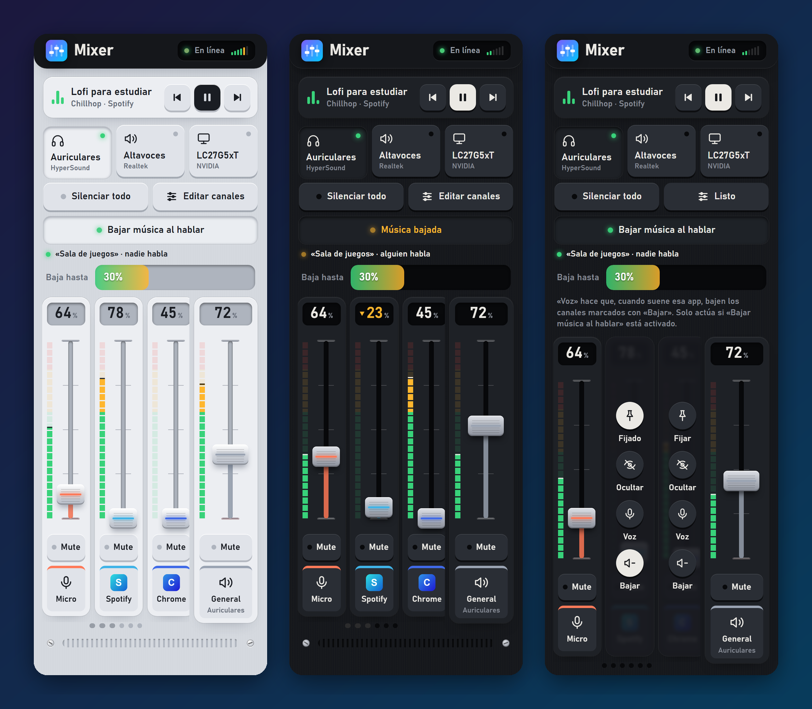
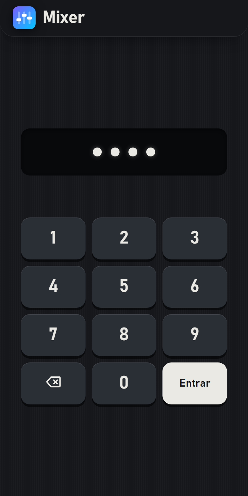
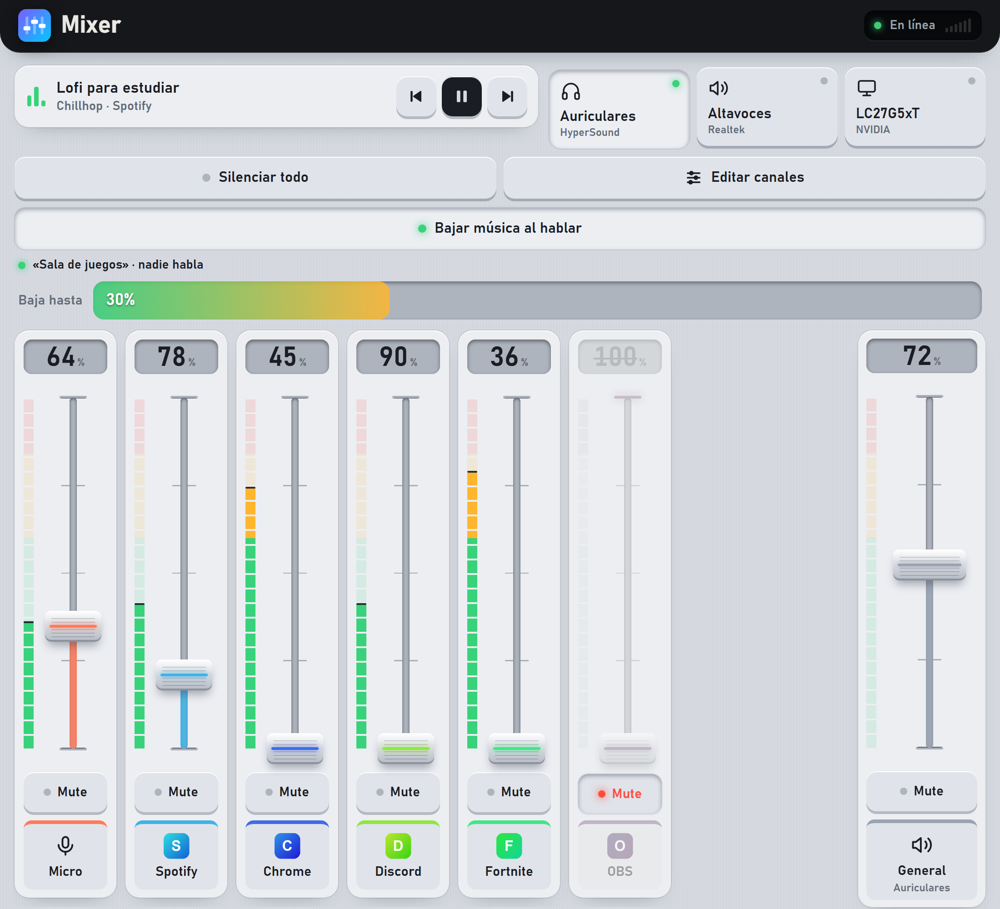

<div align="center">

# 🎚️ Mixer remoto

**Controla el audio de tu PC con Windows desde el móvil.**
Volumen de cada aplicación, salida de audio, música y micrófono, con una interfaz de mesa de mezclas.




</div>

> **English:** a self-hosted web app (Flask + WASAPI) that turns your phone into a per-application audio mixer for a Windows PC — faders, LED meters, output switching, media keys, mic control, and "duck the music when someone talks on Discord". UI in Spanish. No cloud, no accounts, no cost.

---

## ¿Qué es esto?

Un pequeño servidor que corre en tu PC con Windows y una página web que abres desde el móvil (en la misma WiFi). La añades a la pantalla de inicio y se comporta como una app: sube y baja el volumen de **Spotify, Discord, el navegador o ese juego**, cambia de auriculares a altavoces, pausa la música o silencia el micro, sin levantarte del sofá.

No hay nube, ni cuentas, ni nada de pago. Todo pasa entre tu móvil y tu PC.

## ✨ Características

**Mezcla**
- 🎛️ **Un fader por aplicación**, más volumen general y micrófono. Los faders son grandes y se agarran con el pulgar.
- 📊 **Medidores de LEDs en tiempo real** (verde, ámbar y rojo) con marca de pico, para ver qué app hace ruido.
- 🔇 Silenciar cada canal, o **«Silenciar todo»** con un toque y vuelta exacta a como estaba.
- 🖼️ **Iconos reales** de cada programa; el color de cada canal sale de su logo.

**Control**
- 🎧 **Cambio de salida de audio** (auriculares / altavoces / monitor) con un toque.
- ⏯️ **Música**: título, artista, pausa, siguiente y anterior de lo que esté sonando (Spotify, YouTube en el navegador…).
- 📌 **Fijar u ocultar canales** para dejar la mesa limpia.

**Inteligente**
- 🗣️ **Bajar música al hablar**: cuando alguien habla en tu canal de voz de Discord, la música baja sola y vuelve cuando callan. Usa la conexión local de Discord (RPC), así que **no se confunde con música ni avisos**.

**Hecho para usarse**
- 🔒 **PIN** que se pide una sola vez por dispositivo y se recuerda 90 días.
- 📱 **App de pantalla de inicio** con icono propio y sin barra de Safari. Tema claro y oscuro automático.
- 🔄 **Arranca con Windows**, se reinicia solo si falla y se encuentra con el nombre `mixer.local` (sin recordar la IP).
- ⚡ **Tiempo real**: lo que cambias en el PC aparece al instante en el móvil.

<div align="center">

| Pantalla del PIN | Pantalla ancha (tablet / ordenador) |
|:---:|:---:|
|  |  |

</div>

## 🧩 Cómo funciona

```
 Móvil (Safari)              PC con Windows
┌──────────────┐  WiFi   ┌────────────────────────────────────────────┐
│  Interfaz    │◄───────►│  Flask + waitress  ──►  pycaw  ──►  WASAPI │  volumen, medidores,
│  web (PWA)   │  HTTP   │        │                                   │  salida de audio
└──────────────┘  + SSE  │        ├──►  Windows Media Control         │  música
                         │        └──►  Discord RPC (tubería local)   │  quién habla
                         └────────────────────────────────────────────┘
```

- El servidor lee el estado del audio unas 10 veces por segundo y lo empuja al móvil con **Server-Sent Events**. Si el navegador no los soporta, cae a consultas rápidas.
- Las órdenes (volumen, silencio…) viajan como JSON y se aplican con **WASAPI** a través de `pycaw`.
- `zeroconf` anuncia el nombre **`mixer.local`** en tu red.
- Un **vigilante** (`supervisor.py`) arranca el servidor y lo reinicia si se cae o se cuelga.

## 📋 Requisitos

- **Windows 10 u 11** (el audio por aplicación depende de Windows).
- **Python 3.10 o superior**.
- El móvil y el PC en la **misma red WiFi**.
- Para «Bajar música al hablar»: **Discord de escritorio** (no vale la versión web).

## 🚀 Instalación

```powershell
git clone https://github.com/UnaPinyaMas/mixer-remoto.git
cd mixer-remoto
pip install -r requirements.txt
python server.py
```

Al arrancar, el servidor escribe las direcciones para entrar:

```
En el iPhone abre:  http://mixer.local:8080
(o por IP:          http://192.168.x.x:8080)
```

La primera vez, el cortafuegos de Windows preguntará si permites el acceso: **acepta** (en red privada).

### Que arranque solo con Windows

Haz doble clic en **`instalar-autoarranque.bat`**. Crea un acceso en la carpeta de Inicio que arranca el vigilante sin ventana, y lo lanza ahora mismo.

## 📱 Usarlo desde el móvil

1. Conecta el móvil a la misma WiFi que el PC.
2. Abre `http://mixer.local:8080` en Safari (si no abre, usa la IP que muestra el servidor).
3. **Compartir → Añadir a pantalla de inicio.** Ya tienes la app con su icono.

> ⚠️ `mixer.local` solo funciona **dentro de la misma red**. Con datos móviles o desde otra WiFi no llega al PC (para eso haría falta algo como [Tailscale](https://tailscale.com)).

## 🔒 PIN de acceso

Sin PIN, cualquiera de tu WiFi puede abrir el Mixer. Para protegerlo:

```powershell
.\configurar-pin.bat
```

- Elige un PIN de 4 a 8 cifras (se guarda solo su huella, nunca el número).
- Cada dispositivo lo pide **una vez** y lo recuerda 90 días; cada visita renueva el plazo.
- 5 fallos seguidos bloquean 5 minutos (el doble si insiste).
- Desde el propio PC con `http://localhost:8080` no se pide.
- Para quitarlo, ejecuta el mismo script y déjalo vacío.

## 🗣️ Bajar música al hablar (Discord)

Pulsa **«Bajar música al hablar»** y marca, en **Editar canales**, qué apps son la *voz* y cuáles se *bajan*. Por defecto, Discord baja a Brave.

Para detectar **quién habla de verdad** hace falta una aplicación de desarrollador de Discord (gratis, 5 minutos): sigue **[LEEME-DISCORD.txt](LEEME-DISCORD.txt)** y ejecuta `configurar-discord.bat`. Sin ella, se usa el volumen de Discord como aproximación, que falla si en Discord suena música.

## 👀 Modo demo

Para probar la interfaz sin Windows y con datos de mentira:

```powershell
python demo/demo_server.py      # http://localhost:8090
python demo/screenshots.py      # regenera las capturas de este README
```

## 🗂️ Estructura

```
server.py            Servidor: API, audio (WASAPI), música, seguridad y tiempo real
supervisor.py        Vigilante: lo arranca y lo reinicia si falla
discord_rpc.py       Conexión local con Discord para saber quién habla
static/              Interfaz web (index.html, login.html, iconos, manifiesto PWA)
demo/                Modo demo con datos ficticios y generador de capturas
configurar-*.bat     Asistentes para el PIN y Discord
instalar-autoarranque.bat   Arranque con Windows
```

## 🛡️ Seguridad

- Está pensado para una **red doméstica de confianza**. **No lo expongas a Internet.**
- Con PIN: cookie firmada (`HttpOnly`, `SameSite=Lax`), intentos limitados y huella con `scrypt`.
- Solo acepta órdenes en JSON real y solo para los nombres `localhost`, `*.local` o IPs privadas, para evitar que otra web abierta en tu navegador mande órdenes al Mixer.
- `pin.json` y `discord_rpc.json` guardan datos sensibles y están en el `.gitignore`. No los compartas.
- El tráfico va por **HTTP sin cifrar** dentro de tu red.

## ⚠️ Limitaciones conocidas

- Solo Windows.
- Solo aparecen las apps que **ya han reproducido audio**; no se puede mover el volumen de una que no tenga sesión de audio.
- El **widget de pantalla de bloqueo** de iOS no existe (haría falta una app nativa); no se ha hecho.
- Safari de iPhone **no permite vibración**, así que no hay respuesta háptica.
- La conexión RPC de Discord es una función restringida de Discord: funciona con una aplicación tuya y tu cuenta, pero Discord puede cambiarlo.
- Con **ninguna salida de audio activa** (auriculares apagados, etc.), la mesa avisa y espera a que vuelva.

## 🩺 Solución de problemas

| Síntoma | Qué mirar |
|---|---|
| El móvil no abre `mixer.local` | Usa la IP; comprueba misma WiFi; algunas redes aíslan los dispositivos entre sí. |
| «Reconectando…» | El PC está apagado/en reposo o el servidor no corre (`supervisor.log`, `server.log`). |
| «No hay ninguna salida de audio activa» | Enciende los auriculares o conecta unos altavoces. |
| Pide el PIN otra vez | Se borraron los datos del navegador, pasaron 90 días o se cambió el PIN. |
| La música no baja | Revisa la línea de estado de Discord bajo el botón y `rpc.log`. |

## 🗺️ Ideas pendientes

- Temporizador para dormir (bajar el volumen poco a poco y pausar).
- Preajustes de mezcla («Juego», «Noche»).
- Tope de volumen general y nombres de canal editables.
- Acceso desde fuera de casa con Tailscale.

## 📄 Licencia

[MIT](LICENSE). Úsalo, cámbialo y compártelo libremente.
