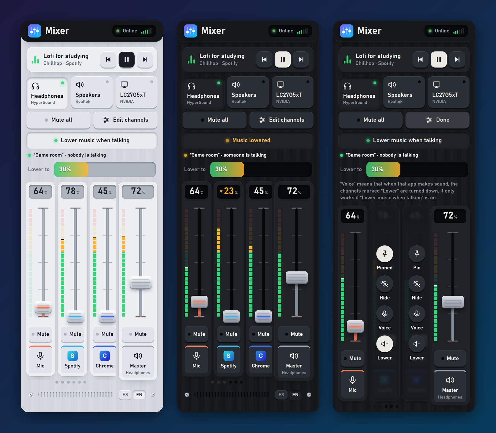
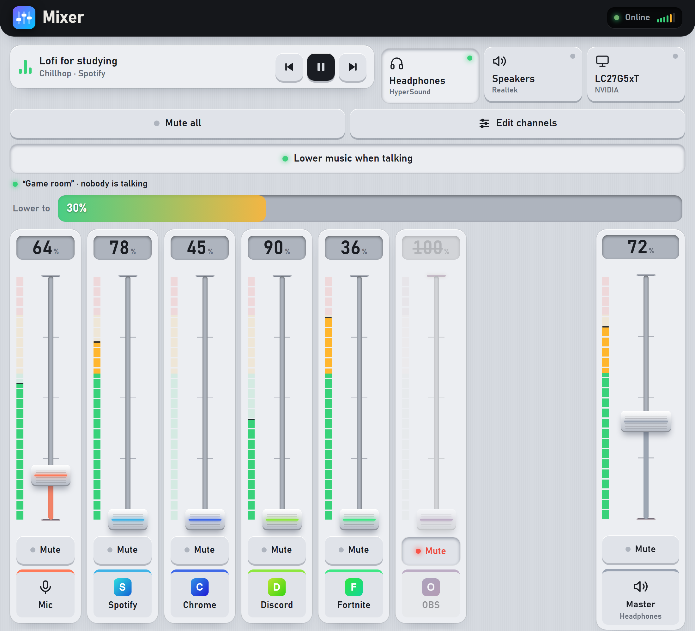

<div align="center">

# 🎚️ Remote Mixer

**Control your Windows PC's audio from your phone.**
Per-application volume, audio output, music and microphone, with a mixing-console interface.

🇬🇧 **English** · 🇪🇸 [Español](README.es.md)




</div>

---

## What is this?

A small server that runs on your Windows PC plus a web page you open from your phone (on the same WiFi). Add it to your home screen and it behaves like an app: turn **Spotify, Discord, your browser or that game** up or down, switch from headphones to speakers, pause the music or mute the mic — without getting off the couch.

There is no cloud, no accounts, nothing to pay. Everything happens between your phone and your PC.

## ✨ Features

**Mixing**
- 🎛️ **One fader per application**, plus master volume and microphone. The faders are big and easy to grab with your thumb.
- 📊 **Real-time LED meters** (green, amber and red) with a peak marker, to see which app is making noise.
- 🔇 Mute each channel, or **“Mute all”** with one tap and an exact return to how it was.
- 🖼️ **Real icons** for each program; each channel's colour comes from its logo.

**Control**
- 🎧 **Audio output switching** (headphones / speakers / monitor) with one tap.
- ⏯️ **Music**: title, artist, pause, next and previous for whatever is playing (Spotify, YouTube in the browser…).
- 📌 **Pin or hide channels** to keep the console tidy.

**Smart**
- 🗣️ **Lower music when talking**: when someone talks in your Discord voice channel, the music goes down by itself and comes back when they stop. It uses Discord's local connection (RPC), so it **isn't fooled by music or notification sounds**.

**Made to be used**
- 🌍 **English and Spanish**: the interface follows your browser's language and has an **ES · EN** button.
- 🔒 **PIN** asked once per device and remembered for 90 days.
- 📱 **Home-screen app** with its own icon and no Safari bar. Automatic light and dark theme.
- 🔄 **Starts with Windows**, restarts itself if it fails, and is found by the name `mixer.local` (no need to remember the IP).
- ⚡ **Real time**: what you change on the PC shows up instantly on your phone.

<div align="center">

| PIN screen | Wide screen (tablet / computer) |
|:---:|:---:|
|  |  |

</div>

## 🧩 How it works

```
 Phone (Safari)              Windows PC
┌──────────────┐  WiFi   ┌────────────────────────────────────────────┐
│  Web         │◄───────►│  Flask + waitress  ──►  pycaw  ──►  WASAPI │  volume, meters,
│  interface   │  HTTP   │        │                                   │  audio output
│  (PWA)       │  + SSE  │        ├──►  Windows Media Control         │  music
└──────────────┘         │        └──►  Discord RPC (local pipe)      │  who is talking
                         └────────────────────────────────────────────┘
```

- The server reads the audio state about 10 times per second and pushes it to the phone with **Server-Sent Events**. If the browser doesn't support them, it falls back to fast polling.
- Commands (volume, mute…) travel as JSON and are applied with **WASAPI** through `pycaw`.
- `zeroconf` announces the name **`mixer.local`** on your network.
- A **watchdog** (`supervisor.py`) starts the server and restarts it if it crashes or hangs.

## 📋 Requirements

- **Windows 10 or 11** (per-app audio depends on Windows).
- **Python 3.10 or newer**.
- Your phone and PC on the **same WiFi network**.
- For “Lower music when talking”: the **Discord desktop app** (the web version doesn't work).

## 🚀 Installation

```powershell
git clone https://github.com/UnaPinyaMas/mixer-remoto.git
cd mixer-remoto
pip install -r requirements.txt
python server.py
```

On start, the server prints the addresses to open:

```
Open on your phone:  http://mixer.local:8080
(or by IP:           http://192.168.x.x:8080)
```

The first time, the Windows firewall will ask whether to allow access: **accept** (on private networks).

### Start automatically with Windows

Double-click **`install-autostart.bat`**. It creates a Startup shortcut that launches the watchdog with no window, and starts it right now.

## 📱 Using it from your phone

1. Connect the phone to the same WiFi as the PC.
2. Open `http://mixer.local:8080` in Safari (if it doesn't open, use the IP the server prints).
3. **Share → Add to Home Screen.** You now have the app with its icon.

> ⚠️ `mixer.local` only works **inside the same network**. On mobile data or another WiFi it can't reach the PC (for that you would need something like [Tailscale](https://tailscale.com)).

## 🔒 Access PIN

Without a PIN, anyone on your WiFi can open the Mixer. To protect it:

```powershell
.\setup-pin.bat
```

- Choose a 4–8 digit PIN (only its hash is stored, never the number).
- Each device asks for it **once** and remembers it for 90 days; every visit renews the period.
- 5 wrong attempts in a row lock for 5 minutes (doubling if it keeps trying).
- From the PC itself, using `http://localhost:8080`, it is not asked.
- To remove it, run the same script and leave it empty.

## 🗣️ Lower music when talking (Discord)

Press **“Lower music when talking”** and, in **Edit channels**, mark which apps are the *voice* and which get *lowered*. By default, Discord lowers Brave.

To detect **who is really talking** you need a Discord developer application (free, 5 minutes): follow the guide **[docs/discord.en.md](docs/discord.en.md)** and run `setup-discord.bat`. Without it, Discord's volume level is used as an approximation, which fails if music plays in Discord.

## 🌍 Language

The interface follows your browser's language (English or Spanish) and can be switched with the **ES · EN** button in the footer. It also accepts `?lang=es` or `?lang=en` in the address. Console messages and logs use the Windows language; force it with `MIXER_LANG=es` or `MIXER_LANG=en`.

## 👀 Demo mode

To try the interface without Windows and with fake data:

```powershell
python demo/demo_server.py      # http://localhost:8090  (?lang=es | ?lang=en)
python demo/screenshots.py      # regenerates the README screenshots
```

## 🗂️ Project layout

```
server.py              Server: API, audio (WASAPI), music, security and real time
supervisor.py          Watchdog: starts it and restarts it if it fails
discord_rpc.py         Local connection to Discord to know who is talking
mixer_i18n.py          Language for console messages and logs
static/                Web interface (index.html, login.html, i18n.js, icons, PWA manifest)
demo/                  Demo mode with fake data and the screenshot generator
docs/                  Guides and screenshots (es / en)
setup-pin.bat          PIN wizard
setup-discord.bat      Discord wizard
install-autostart.bat  Start with Windows
start.bat              Start it by hand, with a window
```

> Code comments are mostly in Spanish.

## 🛡️ Security

- It is meant for a **trusted home network**. **Do not expose it to the Internet.**
- With a PIN: signed cookie (`HttpOnly`, `SameSite=Lax`), limited attempts and an `scrypt` hash.
- It only accepts real JSON commands, and only for the names `localhost`, `*.local` or private IPs, so that another web page open in your browser can't send commands to the Mixer.
- `pin.json` and `discord_rpc.json` hold sensitive data and are in `.gitignore`. Don't share them.
- Traffic is **unencrypted HTTP** inside your network.

## ⚠️ Known limitations

- Windows only.
- Only apps that **have already played audio** appear; you can't move the volume of an app that has no audio session.
- There is no iOS **lock-screen widget** (that would need a native app); it hasn't been built.
- iPhone Safari **doesn't allow vibration**, so there is no haptic feedback.
- Discord's RPC connection is a restricted Discord feature: it works with an application of your own and your account, but Discord may change it.
- With **no active audio output** (headphones off, etc.), the console shows a notice and waits for it to come back.

## 🩺 Troubleshooting

| Symptom | What to check |
|---|---|
| The phone can't open `mixer.local` | Use the IP; check same WiFi; some networks isolate devices from each other. |
| “Reconnecting…” | The PC is off/asleep or the server isn't running (`supervisor.log`, `server.log`). |
| “There is no active audio output” | Turn on your headphones or plug in speakers. |
| Asks for the PIN again | Browser data was cleared, 90 days passed, or the PIN was changed. |
| The music doesn't go down | Check the Discord status line under the button and `rpc.log`. |

More details in the [quick guide](docs/guide.en.md).

## 🗺️ Ideas for later

- Sleep timer (fade the volume down and pause).
- Mix presets (“Gaming”, “Night”).
- Master volume cap and editable channel names.
- Access from outside your home with Tailscale.

## 📄 License

**[PolyForm Noncommercial 1.0.0](LICENSE)**: the code is public and free for **non-commercial** use.

| | |
|---|---|
| ✅ **You can** | Download, use, study, **modify** and share it (including your changes) for personal, hobby, educational, research or non-profit use, **keeping the license notices and the author's name**. |
| ❌ **You can't** | Sell it, include it in a paid product or service, or use it commercially, **without the author's permission**. |
| ✉️ **Commercial use?** | Open an [issue](https://github.com/UnaPinyaMas/mixer-remoto/issues) and let's talk. |

> Because it restricts commercial use, it isn't an “open source” license in the strict OSI sense but a *source-available* one. The libraries the project uses (Flask, pycaw, etc.) keep their own licenses.
>
> This is a plain-language explanation; what counts is the text of the [LICENSE](LICENSE) file.
